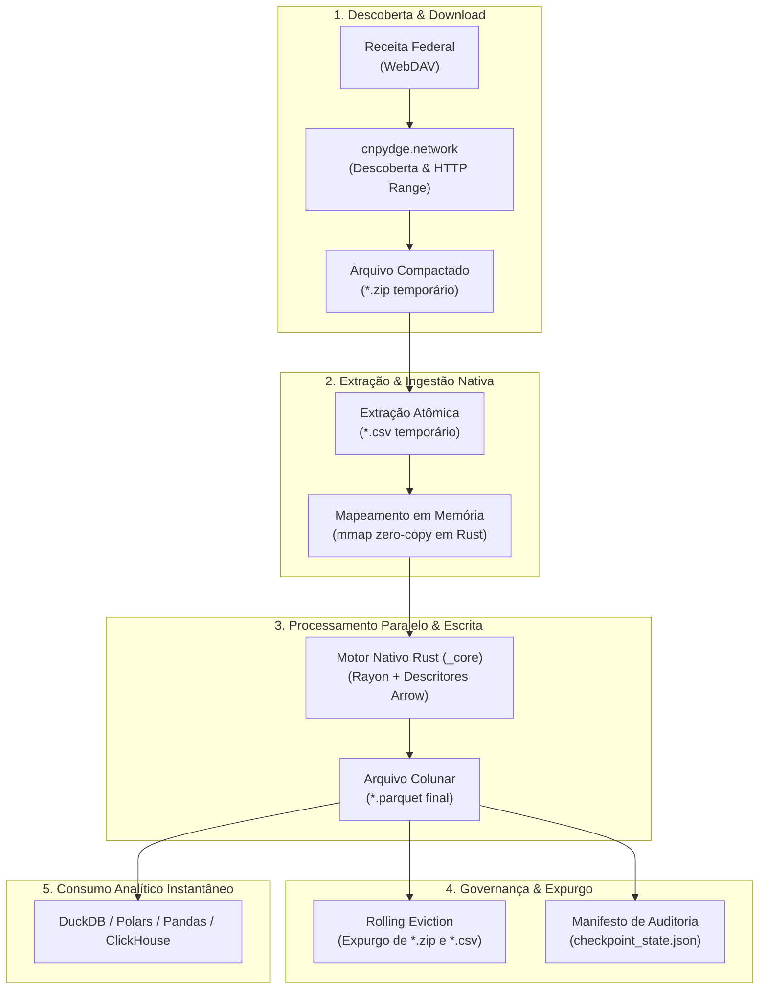

<div align="center">

# CNPydge

### Pipeline de alta vazão para os Dados Públicos de CNPJ da Receita Federal

[](https://github.com/Arkmedess/CNPydge/actions)
[](https://www.python.org/)
[](https://www.rust-lang.org/)
[](tests/)
[](docs/governance/release-and-versioning-policy.md)
[](LICENSE)

<p align="center">
  <b>Motor nativo em Rust zero-copy acoplado a uma interface Python idiomática para ingestão, extração e conversão analítica para Apache Parquet com uso mínimo de disco e memória.</b>
</p>

</div>

---

## Sumário

- [Por que o CNPydge?](#por-que-o-cnpydge)
- [Topologia & Fluxo de Dados](#topologia--fluxo-de-dados)
- [Tabelas Canônicas da Receita Federal](#tabelas-canônicas-da-receita-federal)
- [Instalação Rápida](#instalação-rápida)
- [Modos de Execução](#modos-de-execução)
  - [1. Linha de Comando (CLI)](#1-linha-de-comando-cli)
  - [2. Contêiner Docker & Compose](#2-contêiner-docker--compose)
  - [3. Uso Programático em Python](#3-uso-programático-em-python)
- [Consumo Analítico Instantâneo (DuckDB & Polars)](#consumo-analítico-instantâneo-duckdb--polars)
- [Estrutura do Repositório](#estrutura-do-repositório)
- [Desenvolvimento & Engenharia de Qualidade](#desenvolvimento--engenharia-de-qualidade)
- [Documentação Técnica & Governança](#documentação-técnica--governança)
- [Licença](#licença)

---

## Por que o CNPydge?

A base pública de CNPJs disponibilizada mensalmente pela Receita Federal ultrapassa **50 milhões de registros** distribuídos em dezenas de gigabytes de arquivos compactados. As abordagens tradicionais sofrem com dois gargalos críticos:

1. **Scripts em Python puro:** Sofrem com o gargalo de GIL (*Global Interpreter Lock*), alto consumo de RAM por alocação de strings em lote e lentidão severa de parsing.
2. **Cargas pesadas em bancos relacionais:** Exigem provisionar instâncias de PostgreSQL ou MySQL apenas para viabilizar consultas analíticas que seriam ordens de grandeza mais rápidas em arquivos colunares locais.

O **CNPydge** resolve essa equação combinando a velocidade do **Rust** com a ergonomia do **Python**:

| Aspecto | Pipelines Tradicionais | CNPydge |
| :--- | :--- | :--- |
| **Pico de Armazenamento** | ~70 GB a 100 GB em disco | **~2 a 3 GB** (esteira unitária com *Rolling Eviction*) |
| **Uso de Memória RAM** | Vários gigabytes (pico de buffer) | **Mapeamento de memória (`mmap`)** com paginação pelo SO |
| **Concorrência & CPU** | Travada pelo GIL do Python | **Multithreading em Rust** com liberação total do GIL |
| **Formato de Destino** | Tabelas relacionais lentas ou CSV cru | **Apache Parquet colunar** comprimido e tipado |
| **Regras e CNPJ** | Falhas com strings/zeros à esquerda | Suporte nativo a **CNPJ alfanumérico** e tipagem estrita |

> [!TIP]
> Com o perfil `BALANCED_ROLLING_EVICTION`, o CNPydge baixa cada partição, extrai, converte para Parquet e expurga os arquivos temporários imediatamente antes de avançar para a próxima tabela. Isso viabiliza a execução completa até mesmo em máquinas com armazenamento modesto.

---

## Topologia & Fluxo de Dados

A esteira opera sob um modelo de **esteira unitária com descarte imediato**, garantindo isolamento entre I/O de rede e transformação colunar:



---

## Tabelas Canônicas da Receita Federal

O catálogo do CNPydge possui mapeamento declarativo e descritores colunares para todas as 10 entidades oficiais da base pública:

| Tabela Canônica | Padrão do Arquivo RFB | Descrição dos Dados |
| :--- | :--- | :--- |
| `empresas` | `*Empresas*.zip` | Razão social, natureza jurídica, capital social e porte da empresa. |
| `estabelecimentos` | `*Estabelecimentos*.zip` | CNPJ básico/ordem/DV, matriz/filial, situação cadastral, endereço e CNAEs. |
| `socios` | `*Socios*.zip` | Identificador de sócio, nome, CPF/CNPJ mascarado e qualificação. |
| `simples` | `*Simples*.zip` | Opção pelo Simples Nacional, enquadramento MEI e datas de vigência. |
| `cnaes` | `*Cnaes*.zip` | Tabela de códigos e denominações de atividades econômicas. |
| `motivos` | `*Motivos*.zip` | Tabela de motivos de situação cadastral. |
| `municipios` | `*Municipios*.zip` | Tabela de municípios e códigos IBGE correspondentes. |
| `naturezas` | `*Naturezas*.zip` | Códigos e denominações de naturezas jurídicas. |
| `paises` | `*Paises*.zip` | Códigos e nomes de países. |
| `qualificacoes` | `*Qualificacoes*.zip` | Tabela de qualificações de sócios e representantes legais. |

> [!NOTE]
> Para consultar a tipagem precisa de cada coluna (Apache Arrow DataType) e tamanho de campos, consulte o [Catálogo de Esquemas Colunares](docs/architecture/schemas.md).

---

## Instalação Rápida

O CNPydge pode ser instalado diretamente no ambiente Python via [`uv`](https://docs.astral.sh/uv/) (recomendado) ou `pip`:

```bash
# Instalação rápida via uv
uv pip install .

# Ou via pip convencional
pip install .
```

---

## Modos de Execução

### 1. Linha de Comando (CLI)

O módulo executável permite rodar esteiras automatizadas, agendamentos cronjobs ou pipelines ad-hoc com diagnóstico direto no terminal:

```bash
# 1. Exibir versão e ajuda do despachador
python -m cnpydge --version
python -m cnpydge --help

# 2. Executar esteira completa para tabelas específicas
python -m cnpydge run --output-dir ./dados_parquet --tables empresas,socios

# 3. Executar com perfil de retenção personalizado (balanced_rolling_eviction | performance_batch_retain | archival_permanent_zip)
python -m cnpydge run --output-dir ./dados_parquet --profile balanced_rolling_eviction
```

### 2. Contêiner Docker & Compose

Imagem OCI multi-stage otimizada com execução rootless (UID 10001) para máxima segurança em ambientes de nuvem e Kubernetes:

```bash
# 1. Compilar a imagem local multi-stage
docker build -t cnpydge:latest .

# 2. Executar a esteira montando o volume de saída no host
docker run --rm -v $(pwd)/dados_parquet:/app/data cnpydge:latest run --output-dir /app/data

# 3. Ou executar via Docker Compose
cp .env.example .env
docker compose up
```

### 3. Uso Programático em Python

Integração direta com aplicações Python, esteiras Airflow, Prefect ou scripts analíticos:

```python
from pathlib import Path
import cnpydge

# 1. Execução da esteira completa com esteira unitária (Rolling Eviction)
registros = cnpydge.run_pipeline(
    output_dir="./dados_parquet",
    tables=["empresas", "estabelecimentos"],
    profile=cnpydge.DiskRetentionProfile.BALANCED_ROLLING_EVICTION,
)

for reg in registros:
    print(f"[{reg.stage}] {reg.partition.table_canonical_name} -> {reg.rows_converted} linhas")

# 2. Conversão direta e avulsa de arquivo CSV para Parquet (com liberação de GIL)
total_linhas = cnpydge.to_parquet(
    src=Path("Empresas0.csv"),
    dst=Path("empresas.parquet"),
    kind="empresas",
)
print(f"Total de registros convertidos: {total_linhas}")
```

---

## Consumo Analítico Instantâneo (DuckDB & Polars)

Os arquivos Parquet colunares gerados pelo CNPydge permitem executar consultas analíticas complexas sobre milhões de empresas em frações de segundo, sem necessidade de banco de dados ativo:

### Consulta com DuckDB (SQL puro)
```python
import duckdb

# Top 10 capitais com maior número de empresas ativas
resultado = duckdb.query("""
    SELECT 
        e.municipio,
        COUNT(*) AS total_empresas
    FROM 'dados_parquet/estabelecimentos.parquet' AS e
    WHERE e.situacao_cadastral = '02'
    GROUP BY e.municipio
    ORDER BY total_empresas DESC
    LIMIT 10
""").df()

print(resultado)
```

### Consulta com Polars (Lazy API)
```python
import polars as pl

# Filtrar empresas com capital social acima de 1 milhão
df_filtrado = (
    pl.scan_parquet("dados_parquet/empresas.parquet")
    .filter(pl.col("capital_social") > 1_000_000.0)
    .select(["cnpj_basico", "razao_social", "capital_social"])
    .collect()
)

print(df_filtrado.head(5))
```

---

## Estrutura do Repositório

O projeto é estruturado em fronteiras arquiteturais claras de acordo com os princípios SOLID e as diretrizes do [ADR-0007](docs/adr/0007-desacoplamento-solid-e-descritores-colunares.md):

```text
CNPydge/
├── engine/              # Motor de alto desempenho em Rust (_core)
│   ├── src/             # Leitor mmap, parsers zero-copy, descritores modulares e ArrowWriter
│   ├── benches/         # Harness de benchmarks de vazão com Criterion
│   └── README.md        # Especificação técnica do motor nativo
├── orchestrator/        # Pacote Python de orquestração (cnpydge)
│   ├── cnpydge/
│   │   ├── api/         # Fachadas públicas de alta vazão (converter, to_parquet, run_pipeline)
│   │   ├── network/     # Isolamento de rede (crawler WebDAV e downloader streaming concorrente)
│   │   ├── catalog/     # Contrato de metadados e manifesto de entrega (catalog.json)
│   │   ├── pipeline/    # Esteira unitária, extração atômica, checkpoints e limpeza de disco
│   │   ├── logging.py   # Logging estruturado, formato RFC 3339 e sanitização de credenciais
│   │   └── __main__.py  # Despachador canônico de terminal e contêiner
│   └── README.md        # Documentação da camada de orquestração
├── docs/                # Documentação técnica de arquitetura e governança
│   ├── adr/             # Registros de Decisão Arquitetural (ADRs 0001 a 0007)
│   ├── architecture/    # Visão geral de arquitetura, fluxo de dados e esquemas
│   └── governance/      # Política de versionamento SemVer e release gates
├── tests/               # Suíte automatizada com pytest e testes de integração
├── Dockerfile           # Imagem multi-stage otimizada com usuário não-root (UID 10001)
├── docker-compose.yml   # Orquestração local conteinerizada com limites de recursos
├── ROADMAP.md           # Roadmap de maturidade SemVer e governança de milestones
├── CHANGELOG.md         # Histórico de mudanças (Keep a Changelog + SemVer)
└── pyproject.toml       # Manifest oficial do projeto Python e configuração de ferramentas
```

---

## Desenvolvimento & Engenharia de Qualidade

### Requisitos Prévios
- **Python:** `>= 3.13`
- **Rust:** `>= 1.85` (Rust 2024 Edition)
- **uv:** Gerenciador de pacotes e ambientes ([guia de instalação](https://docs.astral.sh/uv/))

### Setup do Ambiente Local

```bash
git clone https://github.com/Arkmedess/CNPydge.git
cd CNPydge

# 1. Cria o ambiente virtual e sincroniza dependências
uv sync

# 2. Compila a extensão nativa em modo de desenvolvimento
uv run --with maturin maturin develop
```

### Validação de Qualidade & Testes

```bash
# Suíte completa de testes automatizados (Python com cobertura)
uv run pytest --cov=cnpydge

# Suíte de testes do motor em Rust
cargo test --all-targets

# Análise estática, linters e formatação (Zero Warnings)
uv run ruff check .
cargo clippy --all-targets -- -D warnings
cargo fmt --all --check

# Ensaios de desempenho do motor nativo
cargo bench
```

---

## Documentação Técnica & Governança

- **Arquitetura & Especificações:**
  - [Visão Geral da Arquitetura](docs/architecture/overview.md) — Camadas, contratos e fronteiras FFI.
  - [Fluxo de Dados Ponta a Ponta](docs/architecture/data-flow.md) — Topologia de memória e esteira sequencial.
  - [Catálogo de Esquemas Colunares](docs/architecture/schemas.md) — Mapeamento completo de tipos Apache Arrow.
- **Registros de Decisão Arquitetural (ADRs):**
  - [ADR-0001: Arquitetura Híbrida Rust e Python](docs/adr/0001-arquitetura-hibrida-rust-python.md)
  - [ADR-0002: Ingestão via Mmap e Zero-Copy com Liberação de GIL](docs/adr/0002-mmap-zero-copy-e-liberacao-de-gil.md)
  - [ADR-0003: Armazenamento Analítico Colunar em Parquet](docs/adr/0003-armazenamento-analitico-parquet.md)
  - [ADR-0004: Coleta Concorrente e Download Resumable via HTTP](docs/adr/0004-coleta-concorrente-e-download-resumable.md)
  - [ADR-0005: Suporte a CNPJ Alfanumérico e Coerção Estrita de Tipos](docs/adr/0005-cnpj-alfanumerico-e-coercao-de-tipos.md)
  - [ADR-0006: Ingestão por Esteira Unitária e Perfis de Armazenamento](docs/adr/0006-esteira-unitaria-rolling-eviction.md)
  - [ADR-0007: Desacoplamento Arquitetural SOLID e Descritores Colunares Modulares](docs/adr/0007-desacoplamento-solid-e-descritores-colunares.md)
- **Governança & Evolução:**
  - [Roadmap SemVer do Repositório](ROADMAP.md)
  - [Política de Versionamento, Governança de Issues e Ciclo de Releases](docs/governance/release-and-versioning-policy.md)
  - [Histórico de Mudanças (Changelog)](CHANGELOG.md)

---

## Licença

Distribuído sob a licença **MIT**. Consulte o arquivo [`LICENSE`](LICENSE) para mais detalhes.
