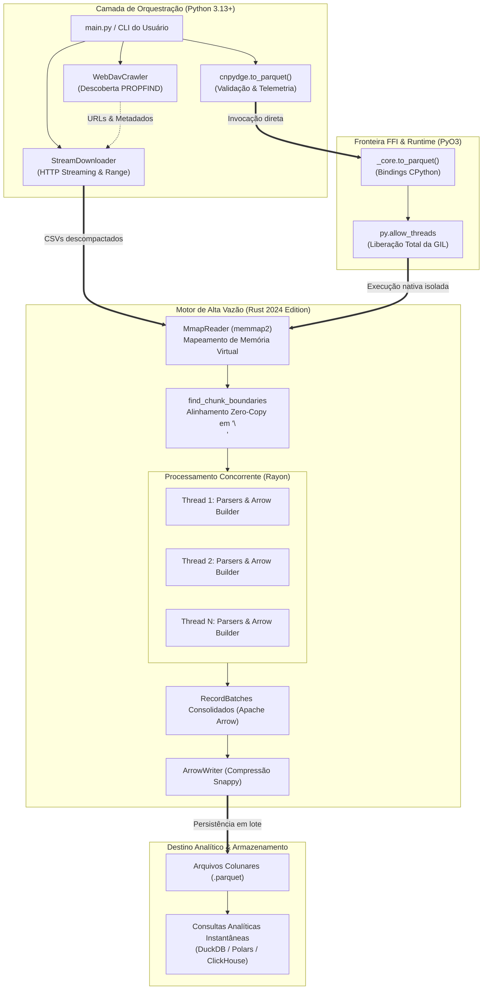

# Visão Geral da Arquitetura do CNPydge

O **CNPydge** é um pipeline híbrido de alta vazão concebido para ingestão, processamento e conversão analítica dos Dados Públicos de CNPJ da Receita Federal do Brasil (RFB).

## 1. Modelo em Camadas

O sistema adota uma separação rigorosa de responsabilidades:

## 2. Componentes Principais

### A. Camada de Orquestração (`orchestrator/cnpydge/`)
- **`crawler.py`:** Cliente HTTP para o repositório WebDAV da Receita Federal via `PROPFIND`, cataloga arquivos disponíveis e extrai metadados (`Content-Length`, `Last-Modified`).
- **`downloader.py`:** Executa downloads atômicos e concorrentes via `httpx.Client`, gerenciando arquivos parciais `.part` e implementando retentativas com cabeçalho `Range`.
- **`pipeline/`:** Módulo de esteira integrada com arquitetura limpa e inversão de dependência (SOLID):
  - `rfb_pipeline_orchestrator.py`: Coordena a esteira unitária sequencial delegando a descoberta para `PartitionDiscoveryProvider` (DIP/LSP).
  - `webdav_partition_discovery.py`: Implementação concreta `WebDavPartitionDiscoveryProvider` para catálogo WebDAV remoto.
  - `partition_models.py`: Entidades de domínio declarativas e catálogo centralizado `RfbTableRegistry`.
  - `pipeline_contracts.py`: Protocolos estruturais (`PartitionDiscoveryProvider`, `PartitionStorageSink`, etc.).
  - `checkpoint_manifest_store.py`: Persistência atômica em JSON do estado e telemetria de cada partição.
  - `zip_archive_extractor.py`: Descompressão atômica de arquivos compactados da RFB.
  - `disk_cleanup_policy.py`: Governança de expurgo imediato (*Rolling Eviction*) por perfil de retenção.
- **`logging.py`:** Padroniza a telemetria com saída colorida no console, formatação RFC 3339 e sanitização ativa de segredos.
- **`__init__.py`:** Expõe a API pública unificada (`run_pipeline`, `to_parquet`), tipos de domínio e validações preliminares.

### B. Fronteira FFI (`engine/src/lib.rs`)
- Compila a crate Rust como biblioteca dinâmica CPython (`_core`).
- Libera o GIL explicitamente via `py.allow_threads` durante a conversão de arquivos.
- Converte exceções internas em `PyRuntimeError`.

### C. Motor Nativo (`engine/src/`)
- **`reader.rs`:** Executa mapeamento de memória (`mmap`) e localiza limites de blocos alinhados a quebras de linha (`\n`) com custo zero de alocação.
- **`converter.rs`:** Orquestrador enxuto que distribui fatias pelo pool Rayon, delega esquemas e montagem de lotes para a trait `TableDescriptor` e escreve em Parquet (Snappy) via `ArrowWriter`.
- **Descritores e Parsers Modulares (`empresa.rs`, `socio.rs`, `estabelecimento.rs`, `simples.rs`, `dominio.rs`):** Cada módulo implementa a trait `TableDescriptor` (`EmpresaDescriptor`, `SocioDescriptor`, `EstabelecimentoDescriptor`, `SimplesDescriptor`, `DominioDescriptor<T>`), encapsulando validação estrita, esquemas Arrow nativos e construção colunar de `RecordBatch`.

## 3. Invariantes Arquiteturais
1. **Sem bloqueio de GIL:** Toda operação de leitura, parsing e escrita que exceda 1ms deve ocorrer fora da GIL do Python.
2. **Memória de I/O Desacoplada da RAM:** O consumo de memória RAM na leitura não escala com o tamanho do arquivo fonte (garantido por `mmap` e streaming HTTP em blocos de 1 MB).
3. **Formatos Imutáveis e Fortemente Tipados:** Arquivos intermediários utilizam `.part` e a saída analítica final é exclusivamente Apache Parquet com esquema Arrow explícito.
4. **Retenção Minimizada de Armazenamento:** A esteira unitária descarta arquivos compactados e CSVs intermediários de forma síncrona pós-conversão, mantendo a pegada em disco restrita a ~2-3 GB no perfil padrão.

