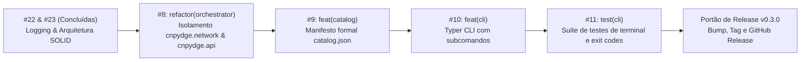

# Política de Versionamento, Governança de Issues e Ciclo de Releases

Este documento define os critérios formais para versionamento semântico (SemVer), rastreabilidade de issues e portões de publicação de releases do projeto **CNPydge**.

---

## 1. Régua de Versionamento Semântico (SemVer)

O CNPydge adota rigorosamente a especificação [SemVer 2.0.0](https://semver.org/lang/pt-BR/):

### A. Fase de Desenvolvimento Pré-v1.0 (`0.y.z`)
Nesta fase, a API e os esquemas estão sendo consolidados:
- **`0.y.0` (MINOR / Fatias Verticais):** Acionado ao entregar novas capacidades funcionais (ex.: esteira unitária, CLI, novos conectores ou refatores estruturais de módulos). Cada milestone do GitHub corresponde a uma versão `0.y.0`.
- **`0.y.z` (PATCH):** Correções de bugs, pequenas melhorias de documentação ou ajustes de infraestrutura que mantêm 100% de retrocompatibilidade com a entrega da milestone.

### B. Portão de Produção Estável (`v1.0.0+`)
O marco `v1.0.0` congela a superfície pública do sistema. A partir dele:
- **`v2.0.0` (MAJOR):** Qualquer quebra em APIs públicas (`cnpydge.*`), alteração incompatível de esquemas Parquet ou remoção de subcomandos de CLI.
- **`v1.x.0` (MINOR):** Novas funcionalidades, novos conectores ou parâmetros adicionados de forma retrocompatível.
- **`v1.0.x` (PATCH):** Correções de bugs que mantêm estrita retrocompatibilidade.

---

## 2. Histórico de Versões Mapeado por Commits

A rastreabilidade histórica do repositório foi formalmente auditada e vinculada aos seus respectivos commits e tags:

| Versão | Commit Canônico | Data | Milestone GitHub | Escopo Entregue |
| :--- | :--- | :--- | :--- | :--- |
| **`v0.1.0`** | `b00181c` | 2026-09-20 | `v0.1.0 - Setup & Fundação` (Closed) | Motor Rust (`_core`), leitor mmap zero-copy, suporte às 10 tabelas da RFB, crawler WebDAV, download em streaming e ADRs 0001 a 0005. |
| **`v0.2.0`** | `ed98769` | 2026-10-03 | `v0.2.0 - Pipeline Integrado & Esteira Unitária` (Closed) | Esteira com rolling eviction, descarte imediato (~2-3 GB disco no pico), manifesto de checkpoints JSON, perfis de retenção e ADR-0006. |
| **`v0.3.0`** | *Em desenvolvimento* | Ativo | `v0.3.0 - Interface de Linha de Comando (CLI) & Observabilidade` (Open) | Observabilidade estruturada e filtros UTC (#22), descritores modulares em Rust e SOLID (#23), reorganização de api/network (#8), catálogo formal (#9) e CLI Typer (#10, #11). |

---

## 3. Critérios do Portão de Release (Release Gate)

Nenhuma release é tagueada ou distribuída sem aprovação em todos os critérios abaixo:

1. **Conclusão Integral da Milestone:** 100% das issues associadas à milestone no GitHub devem estar no estado `closed`.
2. **Qualidade e Testes Aprovados (TQA):**
   - Motor Rust: `cargo test --all-targets` (100% de sucesso).
   - Orquestrador Python: `uv run pytest --cov=cnpydge` (cobertura mantida $\ge 90\%$).
3. **Higienização de Código (Zero Warnings):**
   - Rust: `cargo clippy --all-targets -- -D warnings` e `cargo fmt --all --check`.
   - Python: `uv run ruff check .` e validação de tipagem estrita com `py.typed`.
4. **Sincronização Atômica de Manifests:**
   - A versão deve ser idêntica em `pyproject.toml`, `Cargo.toml` e `engine/Cargo.toml`.
5. **Congelamento do Changelog:**
   - Transferência dos itens de `[Unreleased]` para `[X.Y.Z] - YYYY-MM-DD` em `CHANGELOG.md`.
6. **Commit Canônico de Lançamento:**
   - Commit atômico no padrão: `chore(release): preparar lancamento vX.Y.Z ...`.
7. **Tag Anotada e GitHub Release:**
   - Criação de tag `git tag -a vX.Y.Z -m "Release vX.Y.Z - Titulo"` e publicação no GitHub via `gh release create`.
8. **Fechamento Formal da Milestone:** Fechar a milestone no GitHub e inicializar o ciclo da versão subsequente.

---

## 4. Ordem e Dependência de Execução da Milestone Ativa (`v0.3.0`)

Para garantir um fluxo natural de trabalho sem retrabalho arquitetural, a execução das fatias restantes de `v0.3.0` deve seguir a ordem estrita:

1. **Etapa 1 — Issue #8 (`refactor(orchestrator)`):** Migrar `crawler.py` e `downloader.py` para `cnpydge/network/` e criar `cnpydge/api/`. Dessa forma, todos os novos módulos e comandos importarão das fronteiras definitivas.
2. **Etapa 2 — Issue #9 (`feat(catalog)`):** Criar `manifest_builder.py` e emissão de `catalog.json` como contrato de metadados das partições convertidas.
3. **Etapa 3 — Issue #10 (`feat(cli)`):** Construir a CLI com Typer expondo subcomandos (`run`, `convert`, `download`, `catalog`, `inspect`).
4. **Etapa 4 — Issue #11 (`test(cli)`):** Implementar suíte de testes com `CliRunner` validando exit codes padronizados (0, 1, 2) e separação estrita de `stdout` e `stderr`.
5. **Etapa 5 — Fechamento:** Bump para `0.3.0`, tag `v0.3.0` e GitHub Release.
